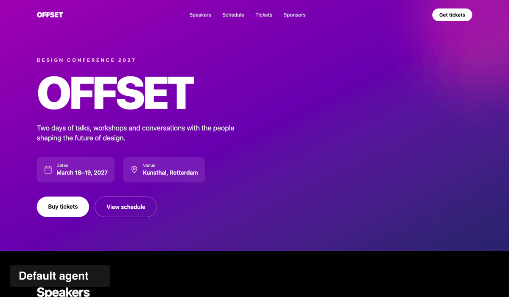
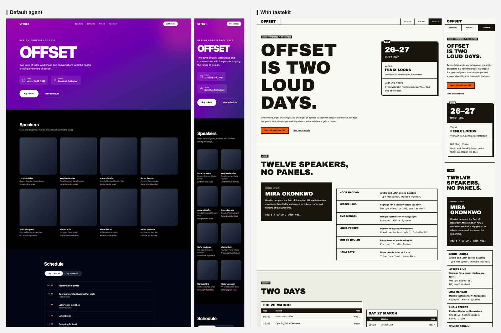
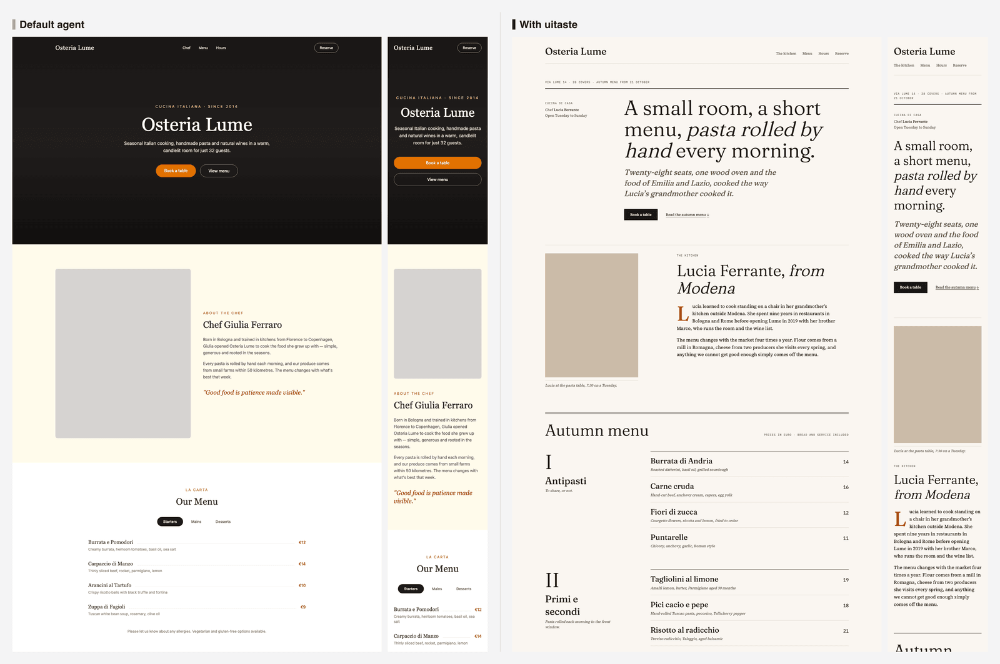
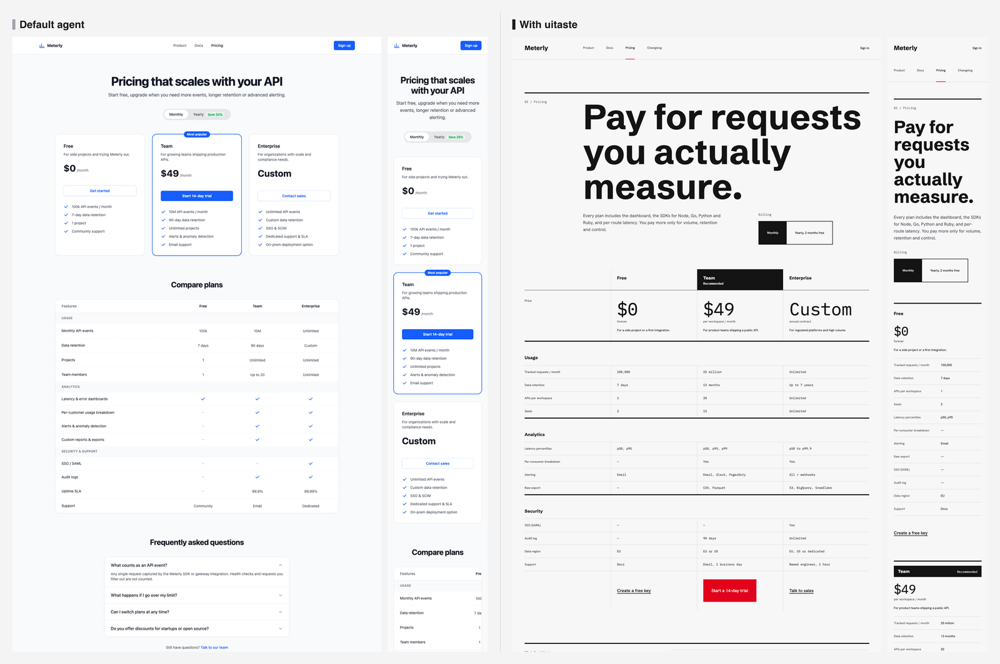
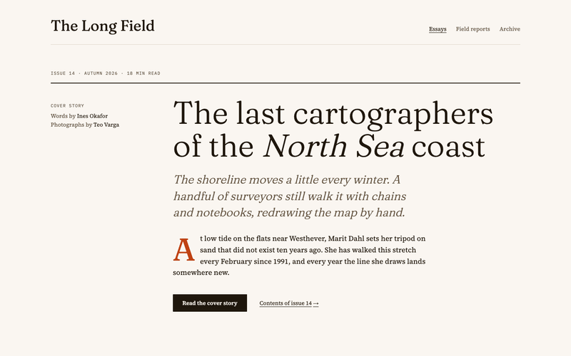
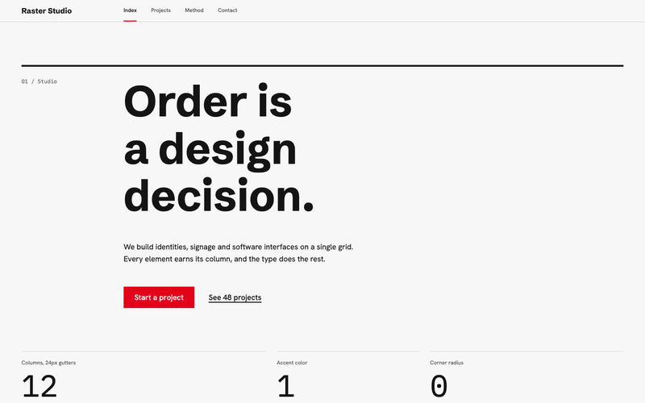
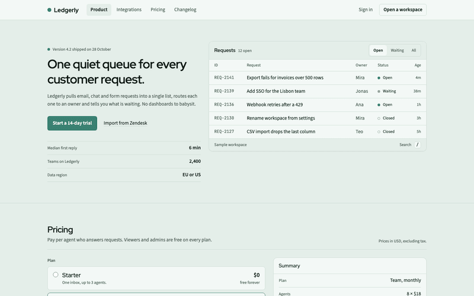
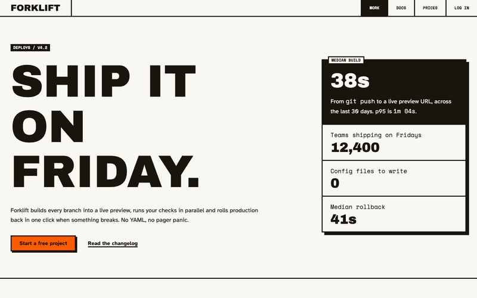

# uitaste

Design tokens, a linter and a screenshot loop that make coding agents (Claude Code, Cursor, Codex) produce frontends that don't look like default AI output.



## What it does

Three levers, all local, no API key:

1. **Presets and tokens.** Four hand-built presets (type, color, radius, spacing, motion, composition rules). `uitaste init` generates the tokens as CSS variables or a Tailwind v4 theme and tells the agent to use only those.
2. **Design linter.** `uitaste lint` flags hardcoded colors, arbitrary values, extra radii, off-token fonts and common AI-default patterns (purple gradients, uniform card grids, emoji icons). Exit code 1 on errors.
3. **Screenshot, critique, fix.** `uitaste shoot` captures routes at 390, 768 and 1440 px. The agent critiques the PNGs against a rubric and fixes what it finds, for at most two rounds.

## Quickstart

In a React project (Tailwind v4 is detected and used if present):

```sh
npx uitaste init --preset editorial   # or: swiss, soft-utility, brutal (omit for a prompt)
npx uitaste lint                      # lints src/**/*.{tsx,jsx,ts,css,html}
```

`init` writes `uitaste.config.json`, `uitaste.tokens.css`, the agent skill in `.claude/skills/uitaste/`, and `.cursor/rules/uitaste.mdc` if a `.cursor` folder exists. Re-running it is safe. Options: `--accent <color>`, `--font <family>`, `--yes` (skip prompts).

Then ask your agent for a page as usual. The skill tells it to use tokens only, lint, shoot and fix.

Screenshots need Playwright in your project:

```sh
npm i -D playwright && npx playwright install chromium
npx uitaste shoot --url http://localhost:5173 --routes /,/pricing   # --breakpoints 390,768,1440, --out <dir>
```

Other commands: `uitaste preset list`, `uitaste preset show <id>` (both take `--json`), `uitaste lint --json --fail-on warn`.

**From source.** To run an unreleased build:

```sh
git clone https://github.com/minn-builds/uitaste.git && cd uitaste && pnpm i && pnpm build
node /path/to/uitaste/packages/cli/dist/main.js init --preset editorial   # run from your project
```

## Before and after

Same prompt for both. Left is the default agent, right is the agent with uitaste installed. Each composite shows 1440 px and 390 px.

**Design conference site (brutal)**


**Restaurant site (editorial)**


**API pricing page (swiss)**


All ten comparisons are in [`bench/out`](bench/out); the prompts are in [`bench/prompts.json`](bench/prompts.json) and the harness in [`bench/scripts`](bench/scripts).

## Presets

|                                                                                                                                             |                                                      |
| ------------------------------------------------------------------------------------------------------------------------------------------- | ---------------------------------------------------- |
| **editorial**: magazine layout, high-contrast serif display, ink on warm paper, one vermilion accent, hairline rules instead of cards.      |        |
| **swiss**: strict 12-column grid, heavy neo-grotesk set flush-left, steep size jumps, black on off-white, one signal red.                   |                |
| **soft-utility**: calm product UI for SaaS and tools, dense 15px type, sage-tinted neutrals, one muted teal accent, layered rounded panels. |  |
| **brutal**: neo-brutalist, square slabs with 3px ink borders and hard offset shadows, oversized uppercase type, one orange flood.           |              |

Override the accent color and display font per project with `--accent` and `--font`.

## Agent setup

`uitaste init` handles Claude Code and Cursor. For manual setup:

**Claude Code.** The skill lives in `.claude/skills/uitaste/` (source: [`packages/skill`](packages/skill)). Claude Code loads it when you ask for UI work.

**Cursor.** If `.cursor/` exists, `init` writes `.cursor/rules/uitaste.mdc` with the preset rules.

**MCP (any client).** The server exposes `list_presets`, `get_preset`, `generate_tokens`, `lint` and `shoot` over stdio:

```json
{
  "mcpServers": {
    "uitaste": {
      "command": "npx",
      "args": ["-y", "-p", "@uitaste/mcp", "uitaste-mcp"]
    }
  }
}
```

The MCP `shoot` tool only accepts local `http(s)` URLs (localhost, 127.0.0.1, `[::1]`) unless `shoot.url` is set in `uitaste.config.json`.

## Lint rules

Errors (token discipline; the build is not done until there are none):

- `no-hardcoded-color`: hex, `rgb()`, named colors and stock palette classes instead of token colors.
- `no-arbitrary-values`: `p-[13px]`-style values instead of the scale.
- `max-radius-variants`: more than 3 distinct radii plus `full`.
- `font-from-tokens`: fonts that are not `font-display`, `font-body` or `font-mono`.

Warnings (AI-default tells):

- `no-default-font`: Inter, Roboto or Arial as the display face.
- `no-purple-gradient`: purple, violet, fuchsia or indigo gradients.
- `no-gradient-text-hero`: gradient-filled headline text.
- `no-uniform-card-grid`: rows of identical rounded cards.
- `no-emoji-icons`: emoji used as icons.
- `no-shadow-everywhere`: shadows on most elements.

Triggers and fixes for each: [`packages/skill/reference/lint-rules.md`](packages/skill/reference/lint-rules.md).

## Benchmark

Ten prompts, each built once by an agent without uitaste (baseline) and once with it, then linted with the same rules. Source: [`bench/out/results.json`](bench/out/results.json). This measures token discipline, not taste; the visual comparison is above.

| Page             | Preset       | Baseline errors | uitaste errors |
| ---------------- | ------------ | --------------: | -------------: |
| saas-landing     | soft-utility |              85 |              0 |
| pricing          | swiss        |              59 |              0 |
| dashboard        | soft-utility |              67 |              0 |
| portfolio        | editorial    |               7 |              0 |
| restaurant       | editorial    |              65 |              0 |
| docs-home        | swiss        |              83 |              0 |
| blog-index       | editorial    |              66 |              0 |
| event-conference | brutal       |              70 |              0 |
| music-release    | brutal       |              27 |              0 |
| fintech-app      | swiss        |              81 |              0 |

## Repository layout

`packages/core` (schema, generator, lint engine), `packages/presets`, `packages/cli`, `packages/mcp`, `packages/skill`, `apps/playground`, `bench`. Product spec in [`docs/PRD.md`](docs/PRD.md).

## Contributing

```sh
pnpm i
pnpm build
pnpm typecheck && pnpm test && pnpm lint
pnpm --filter playground dev   # preset playground on :5173
```

Core logic lives in `packages/core`; the CLI and MCP server are thin wrappers. New dependencies need a one-line reason in [`docs/decisions.md`](docs/decisions.md). Regenerate the README images with `node bench/scripts/readme-assets.mjs`; it needs `pnpm bench` output in `bench/out` and `bench/shots`, plus the local preset shots in `.uitaste/shots/T2.2` and `T2.3`.

## License

MIT, see [LICENSE](LICENSE).
